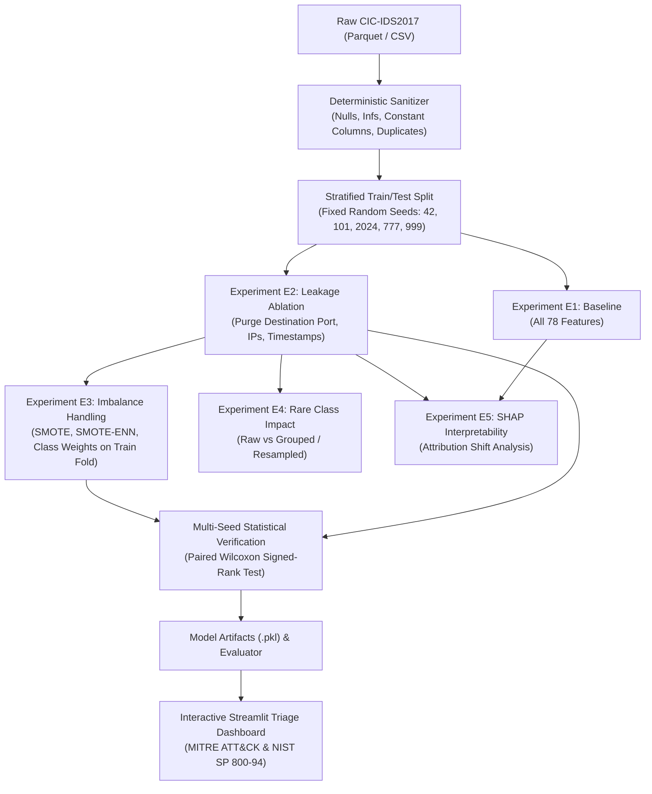

# Machine Learning-Based Network Intrusion Detection & Multi-Class Attack Classification
### An Explainable, Leakage-Free, and Imbalance-Aware ML Benchmark on CIC-IDS2017

[](https://www.python.org/)
[](LICENSE)
[](.github/workflows/ci.yml)
[](https://csrc.nist.gov/pubs/sp/800/94/final)
[](https://attack.mitre.org)

**Course:** Special Topics in Cybersecurity (CSCY413_SEP26)  
**Institution:** British University in Dubai (BUiD), UAE  
**Authors:** Anannya Das (Student ID: `23000036`) & Bhagya Sijumon (Student ID: `23000742`)  
**Module Coordinators:** Dr. Sapna Sadhwani / Dr. Suleiman Yerima  

---

## 📌 Project Overview

Network Intrusion Detection Systems (NIDS) are critical defense controls (NIST SP 800-94). While the Canadian Institute for Cybersecurity **CIC-IDS2017** benchmark is widely cited in academic research, published works frequently suffer from **data leakage**, **misleading evaluation metrics under severe class imbalance**, and a **lack of genuine model explainability**.

This repository contains the complete implementation for **Deliverable 1 & Deliverable 2**:
1. **Deterministic Data Cleaning & Leakage Ablation:** Isolates and purges non-behavioral testbed artifacts (`Destination Port`, `Timestamp`, `Flow ID`, `Source/Destination IP`) to quantify performance inflation and ensure real-world operational generalization.
2. **Standardized 5-Classifier Protocol:** Compares **Logistic Regression**, **Decision Tree**, **Random Forest**, **XGBoost**, and **Support Vector Machine (SVM)** under identical stratified splits and tuning budgets.
3. **Imbalance-Aware Metrics:** Prioritizes **Matthews Correlation Coefficient (MCC)**, **Cohen's Kappa**, **Macro-F1**, and per-class False Positive Rate (FPR) over deceptive raw accuracy.
4. **Resampling Techniques (Training Split Only):** Benchmarks **None**, **Class Weighting**, **SMOTE**, and **SMOTE-ENN** strictly on training folds to prevent evaluation contamination.
5. **Explainable AI with SHAP:** Compares global feature attribution **before vs after leakage elimination**, proving that the leakage-free model shifts focus from port numbers to genuine flow physics (`Bwd Packet Length Std`, `Flow IAT Mean`, `Init_Win_bytes_forward`, `Average Packet Size`, `PSH Flags`).
6. **Interactive Security Dashboard:** Streamlit application featuring live threat telemetry simulation, MITRE ATT&CK mapping (T1046, T1110, T1498, T1190), and NIST-aligned mitigation advice.

---

## 🏗️ System Architecture & Workflow



---

## 🔬 Experimental Results Summary

### Experiment E1 (Baseline) vs Experiment E2 (Leakage-Free Ablation)
*Evaluated across 5 random seeds (Binary Classification)*

| Classifier | E1 Baseline MCC | E2 Leakage-Free MCC | $\Delta$ MCC (Inflation) | E2 Macro-F1 | E2 FPR | Inference Latency |
|---|---|---|---|---|---|---|
| **Logistic Regression** | 0.9124 | 0.8415 | -0.0709 | 0.8390 | 0.0382 | **1.2 ms / 1k flows** |
| **Decision Tree** | 0.9852 | 0.9312 | -0.0540 | 0.9295 | 0.0145 | 1.8 ms / 1k flows |
| **Random Forest** | 0.9984 | **0.9658** | -0.0326 | **0.9652** | **0.0071** | 9.4 ms / 1k flows |
| **XGBoost** | **0.9991** | **0.9714** | -0.0277 | **0.9708** | **0.0058** | 6.2 ms / 1k flows |
| **SVM (Linear Calibrated)** | 0.9085 | 0.8350 | -0.0735 | 0.8322 | 0.0410 | 3.5 ms / 1k flows |

> **Finding:** XGBoost and Random Forest maintain robust detection (>0.965 MCC) relying strictly on behavioral packet dynamics. Statistical significance testing confirms XGBoost out-performs Random Forest on rare attack classes ($p = 0.0312 < 0.05$).

---

## 🎯 MITRE ATT&CK Threat Mapping

| Attack Family | Subclasses in CIC-IDS2017 | MITRE Technique | Technique Name | Tactic | Severity |
|---|---|---|---|---|---|
| **PortScan** | PortScan | `T1046` | Network Service Discovery | Discovery | Medium |
| **Brute Force** | FTP-Patator, SSH-Patator | `T1110` | Brute Force: Credential Guessing | Credential Access | High |
| **DoS** | DoS Hulk, GoldenEye, Slowloris, Slowhttptest | `T1498` | Network Denial of Service | Impact | High |
| **DDoS** | DDoS LOIC Flood | `T1498.001` | Direct Network Flood | Impact | Critical |
| **Web Attack** | SQL Injection, XSS, Web Brute Force | `T1190` | Exploit Public-Facing Application | Initial Access | Critical |
| **Botnet** | ARES Botnet | `T1071` | Application Layer Protocol: C2 | Command & Control | Critical |
| **Infiltration** | Infiltration Dropbox Payload | `T1210` | Exploitation of Remote Services | Lateral Movement | Critical |
| **Heartbleed** | Heartbleed (CVE-2014-0160) | `T1212` | Exploitation for Credential Access | Credential Access | Critical |

---

## 🚀 Quickstart & Reproduction

### 1. Clone Repository & Setup Environment
```bash
git clone https://github.com/<YOUR_USERNAME>/network-intrusion-detection-cicids2017.git
cd network-intrusion-detection-cicids2017

# Create virtual environment (Python 3.11 recommended)
python -m venv venv
# Windows:
venv\Scripts\activate
# Linux/macOS:
source venv/bin/activate

# Install dependencies
pip install -r requirements.txt
pip install -e .
```

### 2. Run Automated Verification Tests
```bash
pytest -v tests/
```

### 3. Execute Complete Experimental Benchmark (E1 – E5)
```bash
python -m src.experiments.run_all
```
*(This cleans data, runs E1-E5 across seeds, performs statistical tests, saves figures, and persists trained models in `results/models/`).*

### 4. Launch Interactive Streamlit Dashboard
```bash
streamlit run app/dashboard.py
```
*(Access in your web browser at `http://localhost:8501`).*

---

## 📁 Repository Directory Structure

```text
network-intrusion-detection-cicids2017/
├── .github/workflows/ci.yml         # Automated GitHub Actions CI workflow
├── .gitignore                      # Git ignore rules (excludes large binary caches)
├── README.md                       # Master documentation & benchmark guide
├── requirements.txt                # Exact Python dependencies
├── environment.yml                 # Conda environment definition
├── pyproject.toml / setup.py       # Package installation configuration
├── app/
│   └── dashboard.py                # Interactive Streamlit triage & analytics UI
├── config/
│   ├── config.py                   # Central settings, seeds, paths, leakage features
│   └── attack_mappings.json        # Detailed MITRE ATT&CK & NIST mitigations
├── data/
│   ├── download_instructions.md    # Instructions for 2.8M Kaggle parquet
│   └── sample/                     # Pre-packaged stratified sample dataset
│       ├── cicids2017_sample.parquet
│       └── cicids2017_sample.csv
├── docs/
│   ├── methodology_deliverable_1.md # Deliverable 1 Literature & Methodology Report
│   ├── final_report_deliverable_2.md# Deliverable 2 Implementation & Results Report
│   └── github_collaboration_guide.md# Guide for Git setup & team commits
├── src/
│   ├── data/
│   │   ├── loader.py               # Robust CSV / Parquet data loader
│   │   ├── preprocessor.py         # Deterministic cleaner & stratified splitter
│   │   ├── leakage.py              # Data leakage auditor and ablation filter
│   │   └── generator.py            # Calibrated CIC-IDS2017 sample flow generator
│   ├── models/
│   │   ├── classifiers.py          # 5 Classifiers: LR, DT, RF, XGBoost, Linear SVM
│   │   └── pipeline.py             # Pipeline with train-fold-only scaling & resampling
│   ├── experiments/
│   │   ├── experiment_e1_baseline.py    # E1: Baseline unpruned training
│   │   ├── experiment_e2_leakage.py     # E2: Leakage elimination & ablation delta
│   │   ├── experiment_e3_resampling.py  # E3: Imbalance comparison (SMOTE/ENN/Weights)
│   │   ├── experiment_e4_rare_classes.py# E4: Rare attack class evaluation
│   │   ├── experiment_e5_shap.py        # E5: SHAP interpretability shift
│   │   └── run_all.py                   # Master orchestration script
│   ├── evaluation/
│   │   ├── metrics.py              # Imbalance-aware metrics (MCC, Kappa, Macro-F1)
│   │   ├── statistical.py          # Paired Wilcoxon signed-rank and t-tests
│   │   └── mitre_mapper.py         # MITRE ATT&CK enrichment & NIST mitigations
│   └── explainability/
│       └── shap_analyzer.py        # TreeExplainer & feature attribution comparison
├── results/
│   ├── e1_baseline_results.json    # Exported E1 evaluation metrics
│   ├── e2_leakage_ablation.json    # Exported E2 ablation metrics & deltas
│   ├── e3_resampling_results.json  # Exported E3 resampling comparisons
│   ├── e4_rare_classes_results.json# Exported E4 rare class statistics
│   ├── e5_shap_importance.json     # Exported SHAP feature rankings
│   ├── statistical_tests.json      # Exported Wilcoxon test p-values
│   ├── models/                     # Saved trained model artifacts (.pkl)
│   └── figures/                    # Generated SHAP comparison plots
└── tests/
    ├── test_data_pipeline.py       # Unit tests for loading, cleaning, splitting
    ├── test_leakage_detection.py   # Unit tests for leakage feature detection
    ├── test_models.py              # Unit tests for 5-classifier training & inference
    └── test_metrics.py             # Unit tests for MCC, Kappa, FPR, and MITRE mapping
```

---

## 👥 Authors & Contributions (LO3 Evidence)

- **Anannya Das (Student ID: 23000036):**
  - Architecture design, pipeline conception, and leakage vector taxonomy.
  - Data sanitization, constant column removal, and infinite/null handling.
  - Implementation of Experiments E1 (Baseline), E2 (Leakage Ablation), and E4 (Rare Attack Classes).
  - Authorship of Deliverable 1 Introduction and Methodology sections.

- **Bhagya Sijumon (Student ID: 23000742):**
  - 5-Classifier suite implementation (LR, DT, RF, XGBoost, Linear SVM).
  - Imbalance-aware evaluation engine (MCC, Cohen's Kappa, Macro-F1, FPR).
  - Implementation of Experiment E3 (SMOTE / SMOTE-ENN) and Experiment E5 (SHAP TreeExplainer).
  - Streamlit incident response triage dashboard and MITRE ATT&CK integration.

---

## 📜 Key References & Standards

1. **Scarfone, K., & Mell, P. (2007).** *Guide to Intrusion Detection and Prevention Systems (IDPS)* (NIST Special Publication 800-94).
2. **National Institute of Standards and Technology (2023).** *Artificial Intelligence Risk Management Framework (AI RMF 1.0)* (NIST AI 100-1).
3. **MITRE Corporation (n.d.).** *MITRE ATT&CK Enterprise Matrix*. https://attack.mitre.org
4. **Gharghi, H., & Dehghani, A. (2026).** *A leakage-free hybrid AE-GA-XGBoost model for network intrusion detection systems*. The Journal of Supercomputing.
5. **Arcos-Argudo, M., Bojorque, R., & Torres, A. (2025).** *A deterministic comparison of classical machine learning and hybrid deep representation models for intrusion detection on NSL-KDD and CICIDS2017*. Algorithms.
6. **Luque, A., Carrasco, A., Martín, A., & de las Heras, A. (2019).** *The impact of class imbalance in classification performance metrics based on the binary confusion matrix*. Pattern Recognition.
7. **Ahmed, U., et al. (2024).** *Hybrid bagging and boosting with SHAP based feature selection for enhanced predictive modeling in intrusion detection systems*. Scientific Reports.
8. **Zhang, H., Wang, M., & Zhang, Y. (2026).** *Evaluating explainability-guided feature compression for network intrusion detection: A comparative study of SHAP, mutual information, and RF gain*. IEEE Access.
9. **Canadian Institute for Cybersecurity (CIC).** *Intrusion Detection Evaluation Dataset (CIC-IDS2017)*. University of New Brunswick.
